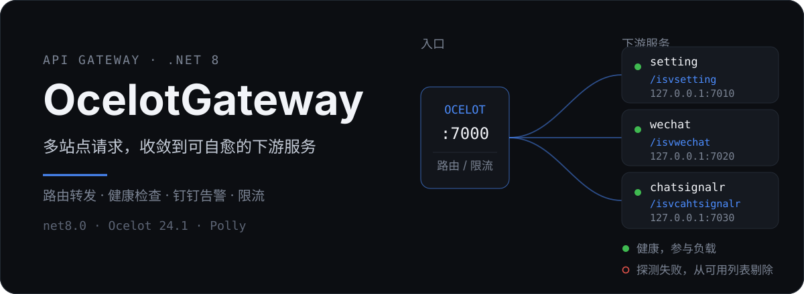
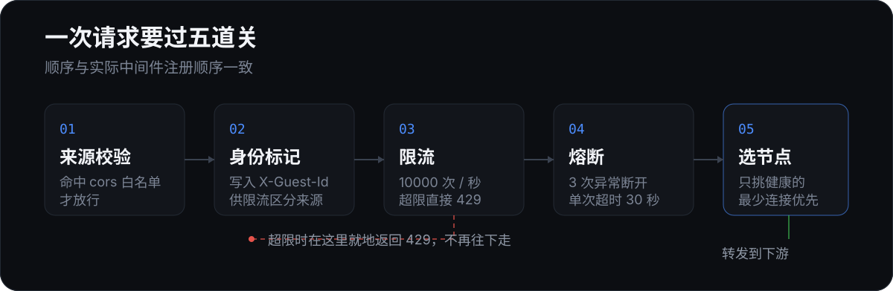

<p align="center">
  
</p>

<p align="center">
  <code>.NET 8</code> · <code>Ocelot 24.1</code> · <code>Polly</code>
</p>

---

## 这是什么

一个建立在 [Ocelot](https://github.com/ThreeMammals/Ocelot) 之上的 API 网关。多个前端站点只对着网关一个地址发请求，由网关按路径前缀分发到不同的下游服务。

当前配置了四条路由（三个下游服务）：

| 网关路径 | 下游服务（`ocelot.json` 的 `ServiceName`） | 协议 |
| --- | --- | --- |
| `/isvsetting/{everything}` | `setting` | HTTP |
| `/isvwechat/{everything}` | `wechat` | HTTP |
| `/isvcahtsignalr/chatHub` | `chatsignalr` | WebSocket |
| `/isvcahtsignalr/{everything}` | `chatsignalr` | HTTP |

下游节点地址在 `appsettings.json` 的 `ServiceDiscovery` 里维护：

| `appsettings.json` 的 `ServiceName` | 地址 |
| --- | --- |
| `setting` | `127.0.0.1:7010` |
| `wechat` | `127.0.0.1:7020` |
| `chatsignalr` | `127.0.0.1:7030` |

> ⚠️ **两张表的服务名必须完全一致，包括大小写**。网关对外路径带 `isv` 前缀（`/isvsetting`），但 `ServiceName` 不带 —— 这两者是不同的东西，改路径不影响服务名。服务发现按名字精确匹配，匹配不到就返回空列表，**该路由会一直 503**。

它做四件具体的事：

- **收敛入口** —— 前端不需要知道下游有几台机器、跑在哪个端口
- **自愈转发** —— 后台定时探测下游节点，探测失败的自动从可用列表摘掉，恢复后自动加回
- **挡住异常流量** —— 按客户端维度限流，超限返回 429；下游连续异常时熔断
- **出问题会喊人** —— 节点连续失败达到阈值，推一条钉钉消息，附带管理页直达链接

下游地址只写在配置文件里，加机器、摘机器改 `appsettings.json` 即可，不用改代码。

## 一次请求要过五道关

<p align="center">
  
</p>

顺序和 `Program.cs` 里中间件的实际注册顺序一致。值得一提的是**身份标记在第 02 步就已经写好**：没有 `Authorization` 头时用来源 IP 兜底，限流和审计都依赖这个值，所以必须在进入 Ocelot 之前定下来。

## 快速开始

```bash
git clone https://github.com/XCHLX/OcelotGateway.git
cd OcelotGateway
dotnet run
```

默认监听 `http://localhost:7000`（见 `Properties/launchSettings.json` 的 `http` 配置）。

跑起来之后确认三个入口：

```bash
# 1. 网关自身的探活
curl http://localhost:7000/homes/ping

# 2. 节点状态管理页（pwd 为当天月日，如 11 月 12 日传 1112）
#    浏览器打开：http://localhost:7000/homes/index?pwd=1112

# 3. 业务请求走网关转发（除 /homes/* 外都交给 Ocelot）
curl http://localhost:7000/isvsetting/your/api/path
```

> 第 3 条能不能通，取决于对应的下游有没有起来。默认写的是本机 `7010` / `7020` / `7030`，端口没监听就会得到 503。

## 配置

只有两份文件需要关心。

### `ocelot.json` —— 路由怎么转

| 字段 | 作用 |
| --- | --- |
| `UpstreamPathTemplate` | 网关对外暴露的路径，如 `/isvsetting/{everything}` |
| `DownstreamPathTemplate` | 转发到下游时的路径，如 `/{everything}` |
| `DownstreamScheme` | `http` 或 `ws`，SignalR 的 WebSocket 路由要写 `ws` |
| `ServiceName` | 关联到 `appsettings.json` 里同名的一组下游节点 |
| `LoadBalancerOptions.Type` | 负载均衡策略，当前为 `LeastConnection`（最少连接优先） |
| `RateLimitOptions` | 限流参数，`Limit: 10000` / `Period: 1s` |
| `QoSOptions` | 熔断与超时：3 次异常断开、断开 10 秒、单次超时 30 秒 |
| `GlobalConfiguration.BaseUrl` | 网关对外地址，钉钉告警里的管理页链接会拼这个值 |

> SignalR 拆成了两条路由：`/isvcahtsignalr/chatHub` 走 `ws` 协议，其余走 `http`。少配一条，长连接就会握手失败。

### `appsettings.json` —— 下游和告警怎么配

```jsonc
{
  "ServiceDiscovery": [
    {
      "ServiceName": "setting",             // 与 ocelot.json 的 ServiceName 对应
      "Alias": "多卖云openApi",
      "DownstreamHostAndPorts": [
        { "Host": "127.0.0.1", "Port": 7010 }
      ],
      "Health": "",                          // 健康检查路径，留空则不做检查
      "TimeOut": 3,                          // 探测超时（秒）
      "DingDingWebHook": "",                 // 钉钉机器人 Webhook
      "DingDingSecret": ""                   // 钉钉机器人加签密钥
    }
    // wechat(7020)、chatsignalr(7030) 同理
  ],
  "ServiceHealthCheckIntervalSeconds": 10,    // 探测间隔（秒）
  "AlertThreshold": 1,                        // 累计失败几次后告警
  "AlertTimeWindow": 300,                     // 失败计数的统计窗口（秒）
  "cors": [ "https://your-site.example.com" ] // 允许跨域的来源白名单
}
```

三处容易踩的地方：

- `cors` 里的每一项要写**完整 origin**，末尾不要带 `/`。改了要**重启进程**才生效，CORS 策略是启动时构建的。
- `Health` 填的是**相对路径**，代码里会拼成 `http://{Host}:{Port}{Health}`，所以健康检查只支持 HTTP。当前三项都留空，等于不做探测、所有节点恒为可用。
- **`ocelot.json` 的 `ServiceName` 必须和 `appsettings.json` 里的完全一致**，包括大小写。对不上时服务发现返回空列表，路由直接 503，且日志里不会报"服务名不存在"。

## 管理页

`http://localhost:7000/homes/index?pwd=MMdd`（`MMdd` 是当天月日）能看到所有下游节点的状态，支持 3/5/10/30 秒自动刷新。页面列出服务名称、实例地址、实例数量、状态四列。

数据来自健康检查写入的内存缓存，所以状态最多滞后一个探测周期。

## 项目结构

```text
BackgroundServices/
  ServiceHealthCheckBackgroundService.cs   定时探测下游，健康结果写入内存缓存
  AlertBackgroundService.cs                消费告警队列，按时间窗口聚合后推钉钉
Controllers/
  HomesController.cs                       管理页与探活接口
Providers/
  MyCustomServiceDiscoveryProvider.cs      从配置读取节点 + 读缓存筛选健康节点
  MyCustomServiceDiscoveryProviderFactory.cs
Dto/                                       配置与传输模型
Utils/
  DingTalkNotifier.cs                      钉钉加签推送
  TextLogger.cs                            文件日志，按天分文件
  Channels/AlertChannel.cs                 告警用的内存 Channel
Views/Homes/Index.cshtml                   节点状态管理页
```

## 已知边界

这些是当前实现里真实存在的限制，按重要性排列：

- **管理页口令是当天月日**，任何人都能算出来；而这个页面会暴露全部下游地址和存活状态。上公网前必须换成真正的鉴权。
- **健康检查只支持 HTTP**，且当前三项都留空，等于没有实际探测。要让自愈真正生效，得给每个服务填上 `Health` 路径。
- **网关前面的反向代理会掩盖真实来源 IP**。部署在 Nginx / SLB 后面时，`X-Guest-Id` 拿到的是代理 IP，限流会退化成所有用户共享一个配额。
- **健康检查缓存失效时会回落到全量节点**：所有节点都探测失败时缓存被清空，服务发现会重新返回配置里的全部节点，而不是空列表。
- 日志写入 `AppContext.BaseDirectory/logs`，没有轮转和清理，长期运行需要外部清理策略。

## License

未指定。